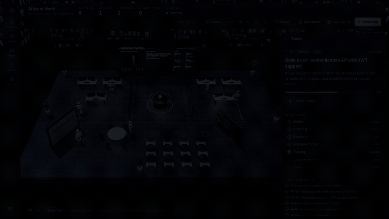
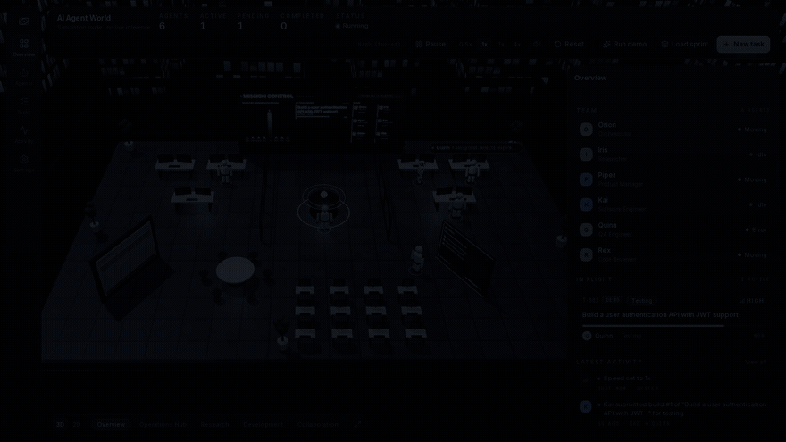

# AI Agent World

A living 3D office in the browser where six AI agents - an Orchestrator, a Product Manager, a Researcher, a Software Engineer, a QA Engineer and a Code Reviewer - walk between labelled stations, exchange glowing messages, fail a test, fix it, get approved and celebrate. Every walk, gesture, screen glow, speech bubble, sound and communication arc is driven by backend state, so nothing on screen is decorative animation that lies about what the system is doing.

**This runs on a deterministic local simulation, not on LLMs.** No model is called and all output is canned. The UI says so plainly ("Simulation mode - no live inference"), and the same contract can be driven by a real orchestrator over WebSocket without touching the 3D layer.



*10 second capture of both views. Higher quality: [docs/demo.mp4](docs/demo.mp4).*

## Quick start

Requires Node 22.7+ or 24+ and any browser with WebGL 2.

```bash
npm install
npm run dev
```

Open [http://localhost:3000](http://localhost:3000), wait about a second, then press **Run demo** in the top bar. In roughly 100 seconds you will see the six robots move between stations, exchange messages, fail a test, fix it and celebrate - with sound - while the side panel and activity feed mirror every step.

No other setup and no runtime assets to download: textures are painted on `<canvas>` at runtime, sounds are synthesised with Web Audio, and the robots are procedural primitives.

## Views and URL flags

The camera bar starts with a **3D / 2D** toggle. The 2D view is a live top-down plan of the same office drawn from the same snapshot: desks with owner names, all stations, agent discs, walking paths, communication arcs and desk glows. Pan with a drag, zoom with the wheel or a pinch, click an agent or desk to open the same panel. Both renderers stay mounted, so switching is instant and keeps the scene state.

- `?view=2d` boots into the floor plan; `?view=3d` forces the 3D office. Without a flag the last choice is restored from `localStorage`.
- `?quality=high` forces shadows, environment reflections, the full skyline and DPR up to 1.75.
- `?quality=low` forces the performance path (no shadows or environment, ~120 skyline towers, capped DPR).
- Without a flag the app picks quality from the machine and drops to low if the frame rate cannot hold.

## The team

| id    | name  | role              | tagline                                             | colour    | home station        |
| ----- | ----- | ----------------- | --------------------------------------------------- | --------- | ------------------- |
| orion | Orion | Orchestrator      | Coordinates work and delegates tasks                | `#E8B04A` | Operations Hub      |
| iris  | Iris  | Researcher        | Researches technical topics and gathers information | `#5CC8D7` | Research Station    |
| piper | Piper | Product Manager   | Converts requirements into actionable tasks         | `#A78BFA` | Product Station     |
| kai   | Kai   | Software Engineer | Implements software features                        | `#6C9EFF` | Engineering Station |
| quinn | Quinn | QA Engineer       | Tests completed work                                | `#5FD39A` | QA Lab              |
| rex   | Rex   | Code Reviewer     | Reviews implementation quality                      | `#F08A7E` | Review Station      |

Each role has its own rig (Orion a taller crown visor, Piper a tablet, Quinn twin sensors, Rex a monocle), a distinct message pitch and a fixed seat, so agents never overlap at shared locations.

## What is in it

**The 3D office.** A dark glass office at blue hour with procedural floor tiles, an instanced skyline behind a dusk window wall, glass partitions, plants and dust motes. The mission-control screen redraws live task titles, phases and progress; the planning board grows sticky cards as subtasks appear; the research board lists findings; desk monitors glow while their owner works.

**The agents.** Procedural robots with blended poses: idle breathing, speed-driven walking, typing, thinking, talking, success bounce and error slump. Each leaves a path trail with a breathing destination ring, communication is a glowing bezier arc with travelling packets, and speech bubbles are DOM pills that track the 3D anchors.

**The UI.** An icon rail (Overview / Agents / Tasks / Activity / Settings), a top bar with live metrics and simulation controls (start/pause, 0.5x to 4x, mute, reset, Run demo, Load sprint, New task), and a side panel with the agent roster, task cards, workflow timelines, the full event feed and rendering settings.

**Sound.** Fully procedural Web Audio: per-agent message pings, keyboard clicks, submit whoosh, failure buzzer, pass and approve chimes, completion fanfare, blocked-task thud and a soft office hum. Mute is persisted.

## Agent activity and communication



The **Agents** tab shows what every robot is doing right now. Select one to see its current task and progress plus two histories: **Activity** (everything that agent did, including failures) and **Communication** (only the agent-to-agent messages). [Higher quality MP4](docs/demo-agents.mp4).

## Controls

Keyboard (ignored while typing or with the dialog open):

| key     | action                                     |
| ------- | ------------------------------------------ |
| `Space` | start / pause / resume the simulation      |
| `N`     | new task dialog                            |
| `B`     | load the 8-task sprint (resumes if paused) |
| `M`     | mute / unmute                              |
| `Esc`   | clear selection, stop following            |

Mouse: click an agent or station to select it and focus the camera; drag to orbit, scroll to zoom; the camera bar has Overview, Operations Hub, Research, Development and Collaboration presets plus a follow mode for the selected agent.

## Two ways to run it

| Mode                 | What drives the robots                              | How to start                                                       |
| -------------------- | --------------------------------------------------- | ------------------------------------------------------------------ |
| Simulation (default) | The deterministic local simulation, no hooks needed | `npm run dev`, then press **Run demo**                             |
| Live (Claude Code)   | Your real Claude Code sessions, through hooks       | `npm run bridge` plus `npm run dev` with two environment variables |

Live mode, in short: start `npm run bridge`, start the app with `NEXT_PUBLIC_AGENT_BACKEND=websocket` and `NEXT_PUBLIC_AGENT_WS_URL=ws://127.0.0.1:8791/ws`, then install the hook block from `bridge/hooks.example.json` so each session and subagent gets a robot. `npm run bridge:replay` posts a scripted session if you want to watch without Claude Code. The bridge is read-only, never stores prompts or tool output, binds loopback only and caps hook calls. See [Connecting Claude Code](#connecting-claude-code).

To use a real orchestrator instead of the bridge, point `NEXT_PUBLIC_AGENT_WS_URL` at any server that speaks the same protocol: JSON commands with a UUID `id` from the client, then `event`, `snapshot` and `ack` messages back. The event vocabulary and message shapes are defined in `src/events/eventTypes.ts`, `src/integrations/AgentBackend.ts` and `src/tasks/taskTypes.ts`.

## Commands

```bash
npm run dev            # Next dev server on :3000
npm run build          # production build
npm run start          # serve the production build
npm run typecheck      # tsc --noEmit (strict)
npm run lint           # eslint over src/
npm run test           # headless simulation suite
npm run bridge         # Claude Code hooks bridge on 127.0.0.1:8791
npm run bridge:replay  # scripted hook session, no Claude Code needed
```

CI runs install, typecheck, lint, the simulation tests and a production build on Node 22 and 24 for every push and pull request.

## Architecture

Three layers with one-way data flow. Rendering never mutates simulation state; every action goes through the backend contract.

```
commands -> AgentBackend (mock simulation | WebSocket client)
                       | events + 30 Hz snapshots
                       v
             Zustand store (mutable liveWorld buffer + throttled React mirror)
                | useFrame                       | React
                v                                v
          three.js canvas                  HTML panels, feed, cards
```

- **Simulation** (`src/simulation`, `src/tasks`, `src/events`, `src/agents`): the whole mock brain in pure TypeScript that also runs in Node. Seeded RNG, per-agent action queues, a priority scheduler (two concurrent tasks), the task state machine and an event bus capped at 400 events.
- **Contract** (`src/integrations`): `AgentBackend` (`connect`, `start`/`stop`/`pause`/`resume`, `reset`, `setSpeed`, `submitTask`, `pauseAgent`/`resumeAgent`, `getSnapshot`, `subscribe`, `subscribeSnapshot`), implemented by `MockAgentBackend` and `WebSocketAgentBackend`. `backendClient.ts` selects by env var.
- **State** (`src/state`): snapshots land in a mutable buffer read by `useFrame`; React updates are throttled to ~160 ms unless a significant signature changed, so the UI never re-renders at 30 Hz.
- **World** (`src/world`) and **UI** (`src/components`): canvas, lighting, workstations, cameras, picking, procedural textures and the HTML shell.

A task moves through `queued -> intake -> planning -> research -> implementation -> testing -> review -> done`, looping back to implementation after a failed test or requested changes, and can be paused to `blocked`. QA fails with probability 0.3 and review requests changes with 0.25, both only below the iteration cap; scripted tasks force exact outcomes so demos are repeatable. Same seed plus same inputs gives the same run, tick for tick.

## Connecting Claude Code

The bridge turns real Claude Code sessions into robots. Hooks POST to a local server; each session and each subagent gets its own robot, and the six core agents mirror the live agent of their role.

1. `npm run bridge` (port 8791, override with `BRIDGE_PORT`).
2. Start the app against it:
   ```bash
   NEXT_PUBLIC_AGENT_BACKEND=websocket \
   NEXT_PUBLIC_AGENT_WS_URL=ws://127.0.0.1:8791/ws \
   npm run dev
   ```
3. Merge the `hooks` block from `bridge/hooks.example.json` into `~/.claude/settings.json` or a project `.claude/settings.json`, replacing the checkout path. The async forwarder exits 0 even when the bridge is down.

In live mode Run demo, Load sprint, New task and the speed control are hidden, because the bridge only watches. `npm run bridge:replay` demonstrates the full flow without Claude Code.

## Testing

`npm test` imports the simulation directly into Node (no browser, no DOM mocking) and checks transition rules, the full demo workflow and phase order, determinism, pause/resume/reset, scheduler priority and the backlog/sprint content. It prints one line per check and exits non-zero on failure.

Browser checks that read the debug probes (`__AAW_RENDER_STATS__`, `__AAW_DEBUG_STATE__` and friends) must run in 3D mode, with `?view=3d` or the default view, because those probes are published by the 3D frame loop.

## More docs

- `docs/spec/ai-agent-world.md` - the full product specification.
- `docs/PLAN.md` - phase plan, pinned versions and review gates.
- `docs/spec/reference-screenshots/` - screenshots of the original build this one matches.

## License

MIT - see [LICENSE](LICENSE).
